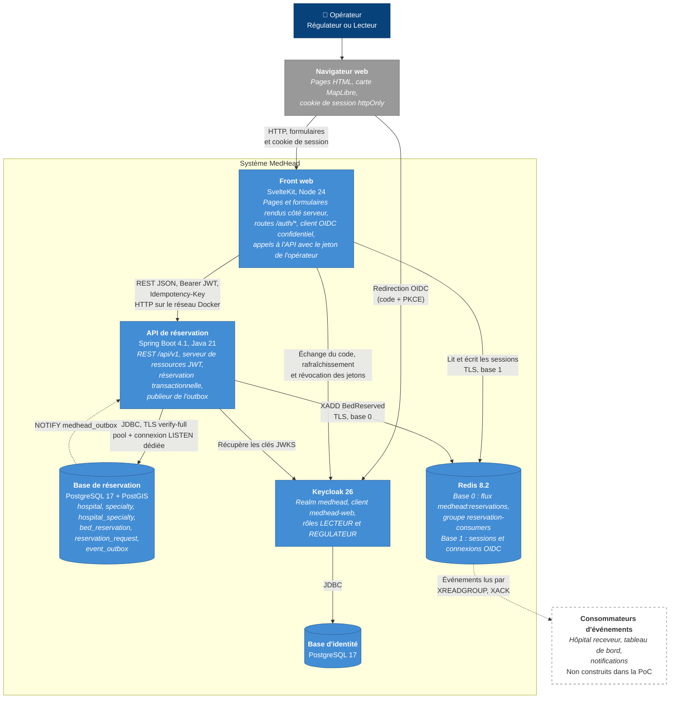

# Diagramme de conteneurs (C4 niveau 2)

Ce diagramme détaille les conteneurs qui composent MedHead, leurs responsabilités et leurs
échanges.

> Établi à partir du commit
> [`b31cfc3`](https://github.com/TheFatAndFurious/MedHead/tree/b31cfc3) de `master`.
> Sources : [`docker-compose.yaml`](https://github.com/TheFatAndFurious/MedHead/blob/master/docker-compose.yaml),
> [`application.properties`](https://github.com/TheFatAndFurious/MedHead/blob/master/src/main/resources/application.properties),
> [`SecurityConfiguration.java`](https://github.com/TheFatAndFurious/MedHead/blob/master/src/main/java/com/example/medhead/security/SecurityConfiguration.java),
> le paquet [`outbox`](https://github.com/TheFatAndFurious/MedHead/tree/master/src/main/java/com/example/medhead/outbox),
> [`frontend/src/lib/server`](https://github.com/TheFatAndFurious/MedHead/tree/master/frontend/src/lib/server)
> et [`+page.server.ts`](https://github.com/TheFatAndFurious/MedHead/blob/master/frontend/src/routes/%2Bpage.server.ts).

## Responsabilités

| Conteneur | Technologie | Responsabilité |
| --- | --- | --- |
| Front web | SvelteKit (adaptateur Node), Node 24 | Affiche la carte et le formulaire de réservation. Mène la connexion OpenID Connect côté serveur : le navigateur ne reçoit qu'un cookie de session opaque, jamais de jeton OAuth. Appelle l'API depuis le serveur avec le jeton d'accès de l'opérateur. Génère la clé `Idempotency-Key` de chaque demande. |
| API de réservation | Spring Boot 4.1, Java 21 | Expose `GET /api/v1/hospitals`, `GET /api/v1/specialties` et `POST /api/v1/hospitals/reservations`. Vérifie les jetons JWT (signature, émetteur, audience `medhead-api`, rôles). Réserve le lit et écrit l'événement dans l'outbox dans une seule transaction. Publie l'outbox dans Redis Streams. |
| Base de réservation | PostgreSQL 17, PostGIS | Porte l'invariant de capacité (`available_beds` entre 0 et `total_beds`), la recherche de proximité (index GiST sur `hospital.location`), l'idempotence des demandes et l'outbox. Schéma versionné par Flyway au démarrage de l'API. |
| Redis | Redis 8.2, TLS, AOF | Base 0 : flux `medhead:reservations`, borné à environ 10 000 entrées, avec le groupe `reservation-consumers`. Base 1 : sessions du front et transactions de connexion OIDC, clés hachées en SHA-256. |
| Keycloak | Keycloak 26.8 | Fournisseur d'identité : comptes de démonstration, rôles `LECTEUR` et `REGULATEUR` placés dans la revendication `roles`, audience `medhead-api` ajoutée au jeton d'accès. |
| Base d'identité | PostgreSQL 17 | Stockage propre à Keycloak, séparé de la base de réservation. |
| Consommateurs | (à construire) | Liraient le flux avec un groupe de consommateurs et dédoublonneraient par `eventId` (livraison au moins une fois). |

## Points d'attention

- **Chiffrement en transit** : PostgreSQL et Redis n'acceptent que des connexions TLS, et
  l'API vérifie le certificat et le nom d'hôte (`sslmode=verify-full`). Le trafic HTTP
  entre le front et l'API, et vers Keycloak, reste en clair sur le réseau Docker interne :
  c'est un compromis assumé de la PoC.
- **Connexion LISTEN dédiée** : le publieur de l'outbox ouvre une connexion PostgreSQL
  hors du pool applicatif, bloquée en attente de `NOTIFY`. Elle ne consomme aucune
  connexion du pool et n'interroge pas la base tant qu'aucun événement n'arrive.
- **Redis partagé** : le flux d'événements et les sessions du front partagent la même
  instance Redis, dans deux bases logiques, avec un seul compte
  ([#3](https://github.com/TheFatAndFurious/MedHead/issues/3)). Un déploiement de
  production les séparerait.
- **Service sans état** : l'API ne garde aucune session (`SessionCreationPolicy.STATELESS`)
  et le front stocke ses sessions dans Redis. Les deux peuvent donc être répliqués.

Le déroulé d'une réservation est détaillé dans le
[diagramme de séquence](sequence-reservation.md), et l'hébergement dans le
[diagramme de déploiement](deploiement.md).
