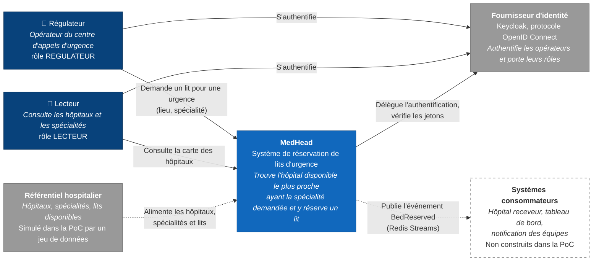

# Diagramme de contexte (C4 niveau 1)

Ce diagramme situe MedHead parmi ses utilisateurs et les systèmes avec lesquels il échange.

> Établi à partir du commit
> [`b31cfc3`](https://github.com/TheFatAndFurious/MedHead/tree/b31cfc3) de `master`.
> Sources : [`SecurityConfiguration.java`](https://github.com/TheFatAndFurious/MedHead/blob/master/src/main/java/com/example/medhead/security/SecurityConfiguration.java),
> [`medhead-realm.json`](https://github.com/TheFatAndFurious/MedHead/blob/master/docker/keycloak/medhead-realm.json),
> [`RedisStreamPublisher.java`](https://github.com/TheFatAndFurious/MedHead/blob/master/src/main/java/com/example/medhead/outbox/RedisStreamPublisher.java),
> [`seed-demo.sql`](https://github.com/TheFatAndFurious/MedHead/blob/master/docker/seed/seed-demo.sql).

## Lecture

- **Régulateur** : seul rôle autorisé à réserver un lit
  (`POST /api/v1/hospitals/reservations`). Il peut aussi consulter les hôpitaux.
- **Lecteur** : consulte la liste des hôpitaux et des spécialités, sans réserver.
- **Fournisseur d'identité** : Keycloak est déployé avec la PoC (realm `medhead`), mais il
  joue le rôle d'un fournisseur d'identité externe. En production, il pourrait être remplacé
  par l'annuaire du consortium sans modifier l'API, qui ne vérifie que des jetons JWT.
- **Référentiel hospitalier** : la PoC ne se connecte à aucun système hospitalier réel. Les
  hôpitaux, leurs spécialités et leurs lits disponibles viennent d'un jeu de données de
  démonstration chargé au démarrage (`seed-demo.sql`). Les spécialités suivent la
  nomenclature du NHS, chargée par une migration Flyway.
- **Systèmes consommateurs** (pointillés) : chaque réservation publie un événement
  `BedReserved` dans un flux Redis, avec un groupe de consommateurs déjà créé
  (`reservation-consumers`). Aucun consommateur métier n'est construit dans la PoC.

Le niveau suivant est décrit dans le [diagramme de conteneurs](conteneurs.md).
