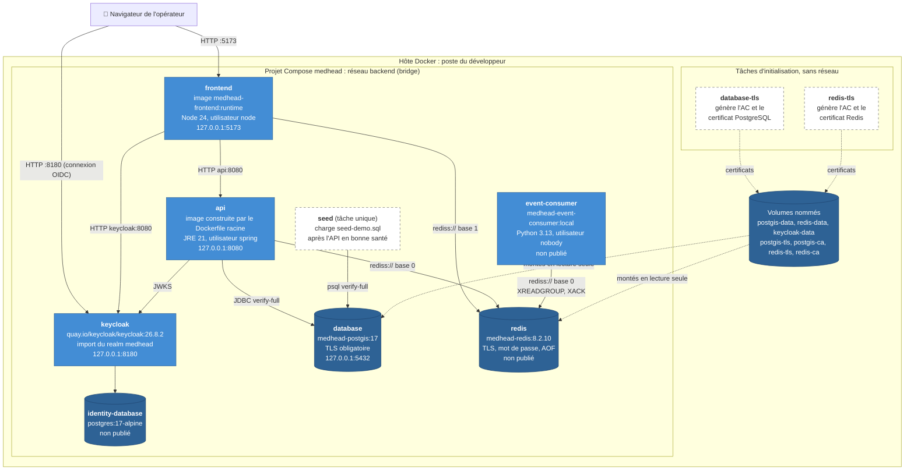
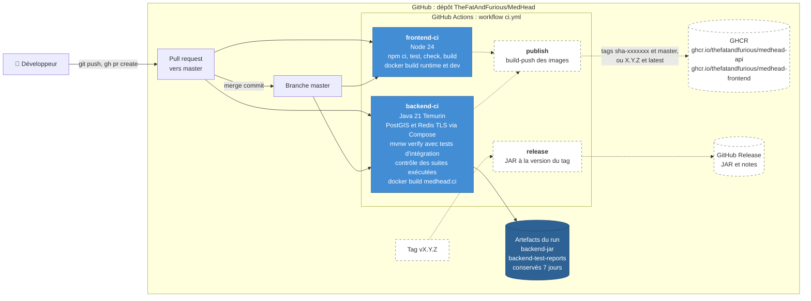

# Diagramme de déploiement

Ce document décrit où s'exécute MedHead : l'environnement Docker Compose local, puis la
chaîne d'intégration continue sur GitHub Actions et la publication des artefacts.

> Établi à partir du commit
> [`b31cfc3`](https://github.com/TheFatAndFurious/MedHead/tree/b31cfc3) de `master`.
> Sources : [`docker-compose.yaml`](https://github.com/TheFatAndFurious/MedHead/blob/master/docker-compose.yaml),
> [`docker-compose.dev.yaml`](https://github.com/TheFatAndFurious/MedHead/blob/master/docker-compose.dev.yaml),
> [`docker-compose.test.yaml`](https://github.com/TheFatAndFurious/MedHead/blob/master/docker-compose.test.yaml),
> [`docker-compose.performance.yaml`](https://github.com/TheFatAndFurious/MedHead/blob/master/docker-compose.performance.yaml),
> [`Dockerfile`](https://github.com/TheFatAndFurious/MedHead/blob/master/Dockerfile),
> [`frontend/Dockerfile`](https://github.com/TheFatAndFurious/MedHead/blob/master/frontend/Dockerfile)
> et [`.github/workflows/ci.yml`](https://github.com/TheFatAndFurious/MedHead/blob/master/.github/workflows/ci.yml).

## Environnement local : Docker Compose

`docker compose up --build` démarre la PoC complète sur un seul hôte. Les ports ne sont
publiés que sur `127.0.0.1` ; Redis et la base d'identité ne sont pas publiés du tout.

### Ordre de démarrage

1. `database-tls` et `redis-tls` génèrent une autorité de certification et un certificat
   serveur dans des volumes, puis s'arrêtent. Ils tournent avec `network_mode: none`.
2. `database`, `redis` et `identity-database` démarrent et exposent un contrôle de santé.
3. `keycloak` attend sa base, puis importe le realm `medhead`.
4. `api` attend PostgreSQL, Redis et Keycloak, applique les migrations Flyway, puis
   expose `/actuator/health/readiness`.
5. `seed` attend que l'API soit prête et charge le jeu de démonstration.
6. `frontend` attend Keycloak et Redis.
7. `event-consumer` attend que Redis soit prêt, crée le groupe `reservation-consumers`
   s'il n'existe pas, puis lit et acquitte les événements.

### Variantes et profils

| Fichier ou profil | Usage |
| --- | --- |
| `docker-compose.dev.yaml` | Superposé au fichier principal : le front passe sur le serveur Vite (cible `dev`) avec `docker compose ... --watch`. |
| `docker-compose.test.yaml` | Projet `medhead-tests` : PostGIS et Redis en TLS seuls, sur les ports 55432 et 56379 par défaut, pour les tests d'intégration de l'API. Utilisé par la CI. |
| `docker-compose.performance.yaml` | Projet `medhead-performance` : pile isolée pour les tests de charge, API sur 58080 et Keycloak sur 58180. |
| Profil `maintenance` | `reset-seed` remet le jeu de démonstration à zéro, `clear-load` efface les données de charge. |
| Profil `performance` | `seed-load` charge le jeu de données des tests de charge. |
| Profil `tools` | `pgadmin` sur 127.0.0.1:5050. |

## Intégration et livraison continues : GitHub Actions

Le workflow `ci.yml` s'exécute sur chaque pull request vers `master`, sur chaque push sur
`master` et à la demande. Les éléments en pointillés sont prévus par l'issue
[TheFatAndFurious/MedHead#21](https://github.com/TheFatAndFurious/MedHead/issues/21) et
n'étaient pas encore sur `master` au commit de référence.

### Étapes du pipeline

- **frontend-ci** : installe les dépendances avec `npm ci`, lance les tests unitaires
  (`npm test`), la vérification des types (`npm run check`) et le build, puis construit les
  deux cibles Docker du front.
- **backend-ci** : démarre PostGIS et Redis en TLS avec `docker-compose.test.yaml`, lance
  `./mvnw clean verify` avec les tests d'intégration activés, vérifie que les quatre suites
  d'intégration ont bien tourné sans être ignorées, construit l'image de l'API et dépose le
  JAR et les rapports de tests en artefacts.
- **publish** et **release** (prévus, #21) : publication des deux images sur GHCR après un
  push sur `master` ou un tag `v*`, et création d'une GitHub Release avec le JAR sur un
  tag. Les images porteront les labels OCI de révision et de version, pour retrouver le
  commit d'origine.

### Cible de production (hors PoC)

La PoC ne s'exécute que sur un poste ou dans la CI. Un déploiement réel reprendrait les
mêmes images, publiées sur GHCR, sur un orchestrateur (Kubernetes, par exemple) avec
plusieurs réplicas de l'API et du front, PostgreSQL et Redis managés, et HTTPS de bout en
bout. Ce passage est discuté dans le [rapport](../reporting/rapport-poc.md).
