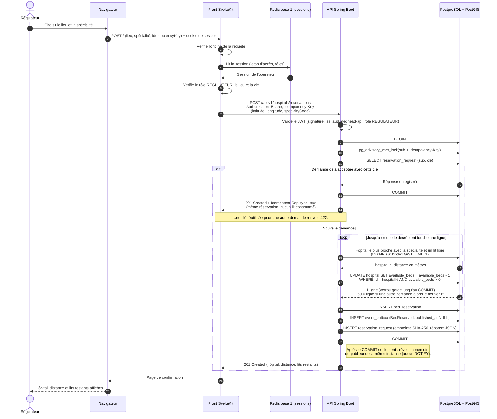
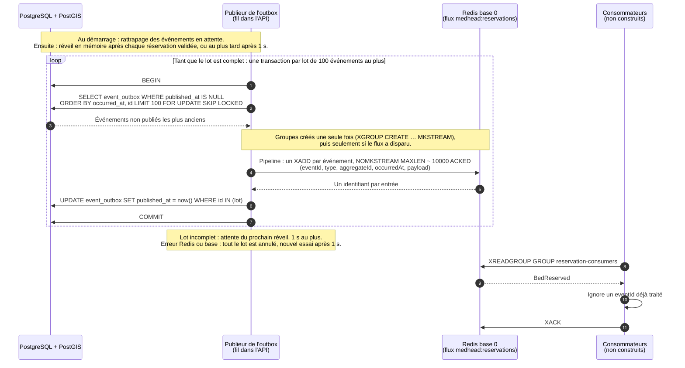

# Séquence d'une réservation de lit

Ce diagramme suit une demande de réservation, du formulaire du régulateur jusqu'à
l'événement `BedReserved` dans Redis Streams.

> Établi à partir du commit
> [`b31cfc3`](https://github.com/TheFatAndFurious/MedHead/tree/b31cfc3) de `master`, puis mis à jour
> pour la publication par lots ([#40](https://github.com/TheFatAndFurious/MedHead/issues/40)) et le
> réveil en mémoire du publieur ([#41](https://github.com/TheFatAndFurious/MedHead/issues/41)).
> Sources : [`+page.server.ts`](https://github.com/TheFatAndFurious/MedHead/blob/master/frontend/src/routes/%2Bpage.server.ts),
> [`hooks.server.ts`](https://github.com/TheFatAndFurious/MedHead/blob/master/frontend/src/hooks.server.ts),
> [`HospitalReservationController.java`](https://github.com/TheFatAndFurious/MedHead/blob/master/src/main/java/com/example/medhead/hospital/api/HospitalReservationController.java),
> [`ReserveNearestAvailableBedService.java`](https://github.com/TheFatAndFurious/MedHead/blob/master/src/main/java/com/example/medhead/hospital/application/ReserveNearestAvailableBedService.java),
> [`HospitalRepository.java`](https://github.com/TheFatAndFurious/MedHead/blob/master/src/main/java/com/example/medhead/hospital/persistence/HospitalRepository.java),
> [`ReservationRequestRepository.java`](https://github.com/TheFatAndFurious/MedHead/blob/master/src/main/java/com/example/medhead/hospital/persistence/ReservationRequestRepository.java),
> [`V7__drop_outbox_notify_trigger.sql`](https://github.com/TheFatAndFurious/MedHead/blob/master/src/main/resources/db/migration/V7__drop_outbox_notify_trigger.sql)
> et le paquet [`outbox`](https://github.com/TheFatAndFurious/MedHead/tree/master/src/main/java/com/example/medhead/outbox).

## Partie synchrone : réserver

Le lit est réservé et l'événement est écrit dans l'outbox **dans la même transaction**.
La réponse est envoyée dès le `COMMIT`, sans attendre Redis.

### Cas d'échec

| Situation | Réponse de l'API | Comportement |
| --- | --- | --- |
| Aucun hôpital n'a de lit pour cette spécialité | `404 Not Found` | La transaction est annulée : aucun lit, aucune demande, aucun événement. La même clé peut être renvoyée plus tard. |
| Spécialité inconnue, coordonnées ou en-tête invalides | `400 Bad Request` | Idem. |
| Clé `Idempotency-Key` déjà utilisée pour une autre demande | `422 Unprocessable Content` | Le front invite à recharger la page pour obtenir une nouvelle clé. |
| Jeton absent, expiré ou sans le rôle `REGULATEUR` | `401` ou `403` | Le front invite à se reconnecter. |
| Pas de réponse de l'API (délai de 10 s dépassé, coupure) | aucune | Le front garde la **même** clé et propose de renvoyer la demande : si la réservation a été enregistrée, elle est renvoyée sans consommer de second lit. |

## Partie asynchrone : publier

Le publieur tourne dans l'API, sur un fil dédié. Il est réveillé en mémoire après chaque
réservation validée par la même instance ; sans réveil, il lit l'outbox au plus toutes les
secondes, pour les événements d'une autre instance arrêtée avant de les publier.

### Garanties

- **Pas de double attribution** : le décrément conditionnel (`available_beds > 0`) et le
  verrou de ligne qu'il pose empêchent deux demandes simultanées de prendre le même
  dernier lit. La contrainte `CHECK (available_beds >= 0)` en est le filet de sécurité.
- **Pas d'événement sans réservation, ni de réservation sans événement** : les deux
  écritures sont dans la même transaction (voir [ADR 0003](../adr/0003-outbox-transactionnelle-redis-streams.md)
  et [ADR 0006](../adr/0006-reserver-puis-publier.md)).
- **Livraison au moins une fois** : si Redis accepte tout ou partie du lot mais que le
  `COMMIT` qui le marque publié échoue, tout le lot sera renvoyé. Les consommateurs
  dédoublonnent par `eventId`.
- **Plusieurs instances de l'API** : `FOR UPDATE SKIP LOCKED` permet à plusieurs
  publieurs de se partager l'outbox sans publier deux fois le même événement en temps
  normal.
- **Données personnelles** : la table `reservation_request` ne garde qu'une empreinte
  SHA-256 des coordonnées de l'urgence, et l'événement ne contient ni position ni identité.
